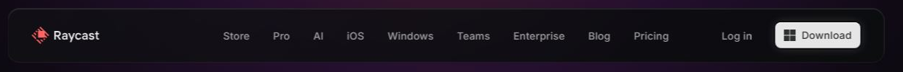

# Barre de navigation

Capture : barre du haut de la page d'extension (la même sur tout le site).

## Relevé raycast.com

**Conteneur** : fixe, marges 16 en haut et sur les côtés.

**Barre** :

| Propriété | Valeur |
|---|---|
| Largeur | 1 204 au plus (le contenu de 1 140, plus 2 × 32) |
| Hauteur | 76 |
| Marges | 16 × 32 |
| Rayon | 16 |
| Fond | `linear-gradient(137deg, rgba(17,18,20,.75) 4.87%, rgba(12,13,15,.9) 75.88%)` |
| Arête | 1 px blanc 6 % |
| Reflet | `rgba(255,255,255,.15) 0 1px 1px 0 inset` |
| Flou d'arrière-plan | 5 px |

**Liens** : 14 px en 500, +0,2 px, Ash `#9c9c9d`, marges 12 × 8, rayon 6, écart 16 ; blancs au
survol, transition de 200 ms. Aucun repère de page ouverte.

**À droite** : « Log in » (lien, même recette), puis le bouton plein de 36
([bouton.md](bouton.md)). **Logo** : 24 de haut, grossit à 1,05 au survol.

DESIGN.md disait : rayon 8, arête `#363739`, flou 48 px, marges 8 × 16, liens de 13 à 14 px.

## Recette Catalog

`NavBar` (`src/app/NavBar.tsx`) ; recette `.nav-glass` (`src/app/globals.css`), partagée avec la
barre d'onglets du bas.

| Élément | Recette |
|---|---|
| Verre | dégradé 137° de `--surface-2` à 75 % vers `--surface` à 90 %, arête `--card-edge`, `--shadow-nav`, flou 5 px, rayon 16 |
| Barre du haut | collante, 12 puis 16 du haut ; 48 de haut (marges 12 et 8) sous 1 024 px, **76** (marges 32) au-delà |
| Menus (dès 1 024 px) | trois déclencheurs par intention (Ta collection, Découvrir, Tes goûts ; décision de l'utilisateur, 2026-09-28), `.nav-trigger` : 14 px en 500, Ash, chevron ; blanc au survol, ouvert, ou quand la page ouverte est dans le menu |
| Panneau | `.mega-panel` sous la barre (Ink, arête blanc 6 %, rayon 16, ombre de fenêtre) : entrées `.mega-item` sur deux colonnes (nom 14 px, précision 12 px en Ash), carte mise en avant `.mega-feature` à droite (décor en éclats, icône, phrase), pied avec un lien `.arrow-link` ; ouvert au survol (80 ms), au clic ou au clavier, fermé par Échap, un clic ailleurs ou un changement de page |
| Actions | réglages, « Ajouter » (secondaires, encadrés ; icône seule sous 1 280 px pour « Ajouter »), « Ce soir » (plein) ; écart 8 |
| Sous la barre | éléments collants et ancres calés à 112 dès 1 024 px (`lg:top-28`, `lg:scroll-mt-28`) |

Écarts assumés :

- Reflet haut à 8 % au lieu de 15 % (pas de lueur, demande de l'utilisateur du 2026-09-28).
- Page ouverte en blanc : Catalog est une app, on doit savoir où l'on est.
- 48 de haut sur téléphone et tablette : la barre d'onglets du bas porte la navigation, la
  barre du haut reste basse.
- Logo à 28 de haut (le symbole de Catalog est plus petit que celui de Raycast à hauteur égale).

## Liste de contrôle

- [ ] Arête à peine visible (blanc 6 %), jamais `#363739`.
- [ ] Rayon 16, plus rond que les boutons qu'elle contient.
- [ ] Verre légèrement translucide : on devine le contenu qui passe dessous, à peine flou.
- [ ] 76 de haut à l'ordinateur ; liens en 14 px, Ash, blancs au survol.
- [ ] Les menus tiennent sur une ligne à 1 024 px ; un seul menu est allumé (celui de la page ouverte).
- [ ] Le panneau s'ouvre au survol et au clavier, se ferme avec Échap ; le focus reste visible sur chaque entrée.
- [ ] Les trois boutons de droite sont encadrés et également espacés.
- [ ] Rien de collant ne passe sous la barre (aside du Changelog, colonne de Ce soir, ancres).
