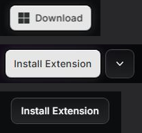

# Bouton

Captures : barre du haut (Download), page d'extension (Install Extension et son chevron),
cartes vedettes du Store (Install Extension sombre).

## Relevé raycast.com

**Plein** (`Button light`) :

| Propriété | Valeur |
|---|---|
| Fond | `#e6e6e6` ; `#ffffff` au survol |
| Texte | `#2f3031`, 14/16, 500, +0,2 px |
| Hauteur | 36 (barre), 40 (page d'extension) |
| Marges | 8 × 12, écart 8 |
| Rayon | 8 |
| Ombre | `rgba(0,0,0,.5) 0 0 0 2px, rgba(255,255,255,.19) 0 0 14px 0, rgba(0,0,0,.2) 0 -1px .4px 0 inset, #fff 0 1px .4px 0 inset` |
| Transition | fond et ombre 200 ms, transformation 100 ms |

**Sombre** (`Button dark`) :

| Propriété | Valeur |
|---|---|
| Fond | `linear-gradient(rgba(255,255,255,.03) 0%, rgba(255,255,255,.1) 100%)` |
| Texte | blanc, 14/16, 500, +0,2 px |
| Hauteur | 36 ; marges 8 × 12 ; rayon 8 |
| Ombre au repos | `rgba(255,255,255,.05) 0 1px inset, rgba(255,255,255,.25) 0 0 0 1px, rgba(0,0,0,.2) 0 -1px inset` |
| Survol | anneau à 50 % |
| Appui | anneau à 15 % |
| Focus | anneau de 2 px à 50 % |
| Désactivé | opacité 0,3, plus de reflet haut |

## Recette Catalog

`Button` et `buttonClass()` (`src/components/ui/Button.tsx`) posent `.btn` et une variante
(`src/app/globals.css`).

| Variante | Recette |
|---|---|
| `primary` | `--accent` (Mist), texte `--accent-foreground` (Slate), `--shadow-button` ; blanc au survol |
| `secondary` | `--key-fill`, `--shadow-key` (anneau 12 %) ; `--shadow-key-hover` (20 %) au survol, `--shadow-key-active` (8 %) à l'appui |
| `ghost` | texte Ash ; blanc 5 % et texte blanc au survol |
| `glass`, `overlay` | sur le contenu, sur une affiche (pas de modèle Raycast) |
| `danger` | aspect de `primary` : aucun bouton de couleur, le libellé dit l'action |

Tailles : `sm` 28, `md` 36, `lg` 40 à la souris ; 32, 40, 44 au doigt. Appui : échelle 0,97 en
100 ms.

Écarts assumés :

- **Halo du bouton plein adouci** (demande de l'utilisateur, 2026-09-28) : blanc 8 % sur
  10 px au lieu de 19 % sur 14 px ; cerne noir et reflets inchangés.
- **Anneau du bouton sombre adouci** (demande de l'utilisateur, 2026-09-28) : 12 % au repos,
  20 % au survol, 8 % à l'appui, au lieu de 25, 50 et 15 % sur le site.
- **Focus** : le focus commun de Catalog, un anneau de 2 px blanc à 40 % décalé de 2 px, sans
  halo (3,6:1 sur le fond). Le relief du bouton reste en place pendant le focus.
- Désactivé : opacité 0,4 (0,3 sur le site), pour rester lisible.
- `sm` (28) n'existe pas sur le site ; il sert aux barres denses.

## Liste de contrôle

- [ ] Un seul bouton plein par vue, pour l'action principale.
- [ ] Texte du bouton plein en Slate `#2f3031`, pas en Iron ni en noir.
- [ ] Le bouton plein a son cerne noir et un halo blanc à peine perceptible, jamais une lueur.
- [ ] Le bouton secondaire a un voile qui s'éclaircit vers le bas et un anneau discret (12 %) ;
      au survol, seul l'anneau change (20 %), pas le fond.
- [ ] Focus clavier : anneau gris décalé, jamais de filet blanc plein ni de halo large ; rien au
      clic de souris.
- [ ] Hauteur 36 pour un bouton ordinaire, 40 pour l'action principale d'un en-tête.
- [ ] 14 px en 500, interlettrage positif ; icône de 14 à 15 px, écart 8.
- [ ] Aucun bouton de couleur, même pour supprimer.
