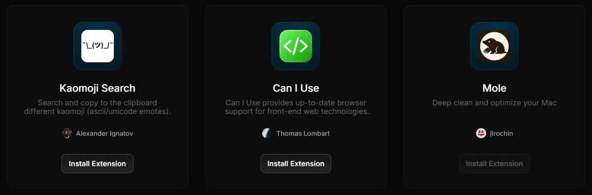

# Carte, tuile

Capture : cartes vedettes (« Featured ») du Store. La carte d'extension de la liste a la même
recette, en ligne.

## Relevé raycast.com (`ExtensionCard`, `FeaturedExtensionCard`)

| Propriété | Valeur |
|---|---|
| Fond | `#0c0d0f` (pseudo-élément `::before`) |
| Arête | 1 px blanc 6 % |
| Reflet | `rgba(255,255,255,.05) 0 1px inset` |
| Rayon | 12 |
| Marge intérieure | 32 |
| Survol | `::after` : `radial-gradient(100% 100% at 50% 0%, #111214 0%, #1b1c1e 150%)`, opacité 0 → 1 en 150 ms |
| Focus | anneau intérieur de 2 px blanc 30 % |
| Appui | échelle 0,98 |
| Ombre portée | aucune |
| Titre (vedette) | 20/23, 500, blanc, centré |
| Description (vedette) | 15/17, 400, Smoke |
| Icône | 32 (liste) ; tuile de 96 (vedette) |

DESIGN.md disait : rayon 16, relief « touche » à anneau blanc 25 %, fond transparent. Le site
n'a pas d'anneau clair sur ses cartes : l'arête est à peine visible.

## Recette Catalog

`Card` (`src/components/ui/primitives.tsx`) : `key` pose `.card`, `tile` pose `.card-soft`,
`edge` pose `.panel`. Les tuiles cliquables d'une liste portent `.tile`.

| Recette | Valeurs |
|---|---|
| `.card`, `.card-soft` | fond `--surface` (Onyx), arête `--card-edge`, `--shadow-card`, rayon `--r-card` (12) ; cliquable (`a`, `button`, `role="button"`) : `--card-fill-hover` au survol |
| `.tile` | même surface, rayon 12, icône, nom, précision ; `--card-fill-hover` au survol, échelle 0,98 à l'appui |
| `.panel` | carte à arête transparente, rayon 20 (pas de modèle relevé) |

Marge intérieure : fixée à l'appel (`p-4`, `p-6`, `p-8` pour une carte vedette).

Écarts assumés :

- La lueur de survol apparaît sans fondu (un dégradé ne s'anime pas en CSS sans pseudo-élément) ;
  à reprendre si le fondu manque.
- Description en Ash, pas en Smoke (contraste).

## Liste de contrôle

- [ ] Arête à peine visible (blanc 6 %), jamais un anneau clair ni une bordure `#363739`.
- [ ] Rayon 12.
- [ ] Aucune ombre portée.
- [ ] Carte cliquable : s'éclaire d'en haut au survol ; carte inerte : ne réagit pas.
- [ ] Carte vedette : contenu centré, titre 20 px en 500, marge 32, écart de 32 entre cartes.
