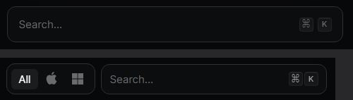

# Champ de recherche, champ de saisie, touches

Captures : recherche sous le titre « Store », recherche de la barre de liste.

## Relevé raycast.com

**Recherche** (un bouton qui ouvre la palette) :

| Propriété | Héros du Store | Barre de liste |
|---|---|---|
| Hauteur | 51 | 43 |
| Marge intérieure | 16 | 12 |
| Fond | `#0c0d0f` | idem |
| Arête | 1 px `#2f3031` ; `#9c9c9d` au survol | idem |
| Rayon | 12 | 12 |
| Texte | 15/17, 400, indication en Smoke `#6a6b6c` | idem |
| Icône | **aucune loupe** | aucune |
| Focus | anneau de 2 px à 50 % | idem |

**Raccourci** (⌘ K à droite) : écart 6 ; chaque touche fait 20 × 20, rayon 4, arête blanc 6 %,
fond `radial-gradient(100% 100% at 50% 0%, #111214 0%, #1b1c1e 150%)`, reflet haut blanc 5 %,
11 px en 500, Smoke.

**Champ de formulaire** (lettre d'information) : 42 de haut, marges 8 × 12, fond blanc 5 %,
arête 1 px blanc 5 %, rayon 8, 14/16 en 500, +0,2 px.

## Recette Catalog

`SearchField` (`src/components/ui/form.tsx`) pose `.field .field-search` ; `Kbd` pose `.kbd`.

| Élément | Recette |
|---|---|
| Recherche | 44 de haut, marges 0 × 12, rayon 12 (`--r-frame`), fond `--surface` (Onyx), arête `--field-edge` (blanc 8 %) ; `--field-edge-hover` (14 %) au survol |
| Saisie (focus) | arête `--field-edge-focus` (24 %) et halo de 3 px `--focus-ring` (blanc 6 %), sans filet, à la souris comme au clavier |
| Texte | 16 px sur téléphone (pas de zoom iOS), 14 px dès 640 px ; indication en Ash |
| En cours | le bas du champ balaie (`searching`) |
| Effacer | une croix remplace le raccourci dès qu'il y a du texte (`onClear`) |
| Touche | 20 × 20, rayon 4, arête `--card-edge`, `--card-fill-hover`, `--shadow-card`, 12 px en 500, Ash |
| Champ de formulaire | `.field` : blanc 5 %, arête blanc 5 % (`--contrast-subtle`), rayon 8 ; survol et saisie comme la recherche |

Écarts assumés :

- **Arête adoucie** (demande de l'utilisateur, 2026-09-28) : blanc 8 % au lieu de Slate
  `#2f3031`, et 14 % au survol au lieu d'Ash.
- **Focus doux** : arête qui s'éclaircit et halo léger, plutôt que l'anneau de 2 px à 50 %.
- Indication et touches en Ash plutôt qu'en Smoke (contraste lisible, AC-5.2) ; touches à 12 px
  (plancher).
- 44 de haut dans les deux cas (une seule taille).

## Liste de contrôle

- [ ] Pas de loupe dans le champ.
- [ ] Fond Onyx et arête à peine visible, rayon 12 (plus rond qu'un bouton).
- [ ] L'arête s'éclaircit au survol, puis un peu plus à la saisie ; le fond ne change pas.
- [ ] À la saisie : ni filet blanc, ni halo large.
- [ ] Raccourci en petites touches carrées de 20, à droite, écart 6.
- [ ] Un champ de formulaire (pas une recherche) reste en creux blanc 5 %, rayon 8.
