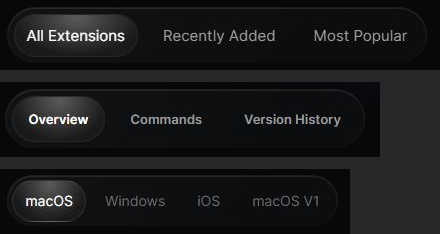

# Onglets (contrôle segmenté)

Captures, de haut en bas : filtre de liste du Store, navigation de la page d'extension,
plateformes du Changelog.

## Relevé raycast.com

**Rail** :

| Propriété | Store | Page d'extension | Changelog |
|---|---|---|---|
| Fond | `linear-gradient(137deg, #111214 4.87%, #0c0d0f 75.88%)` | idem | idem |
| Ombre | reflet haut `rgba(255,255,255,.1) 0 1px 0 0 inset` ; **aucune arête** | idem | idem |
| Marge intérieure | 6 | 6 | 4 |
| Écart | 12 | 8 | 6 |
| Hauteur | 56 | 59 | 51 |
| Rayon | pastille | pastille | pastille |

**Option** :

| Propriété | Store | Page d'extension | Changelog |
|---|---|---|---|
| Hauteur | 43 | 46 | 42 |
| Marges | 12 | 12 × 16 | 12 |
| Texte | 15/17, 400 | 13/20, 600 | 14/16, 400 |
| Couleur au repos | Ash `#9c9c9d` | Ash | Smoke `#6a6b6c` |
| Survol | blanc, transition de couleur 300 ms | idem | idem |
| Arête | 1 px transparente (la taille ne bouge pas une fois choisie) | idem | idem |

**Option choisie** : fond `radial-gradient(51.07% 92.4% at 51% 7.61%, #5a5a5a 0%, #1a1a1a 100%)`,
arête 1 px blanc 10 %, texte blanc, pastille.

## Recette Catalog

`Tabs` (`src/components/SegmentedControl.tsx`, exporté par `@/components/ui`) pose `.segmented`,
une `.segmented-pill` qui glisse d'une option à l'autre (préréglage `slide`) et des
`.segmented-item`.

| Élément | Recette |
|---|---|
| Rail | `--rail-fill`, reflet haut blanc 6 %, marge 6, écart 8 |
| Option | 42 de haut, marges 0 × 16, 14/16 en 500, +0,014em, Ash ; blanc au survol |
| Pastille | `--pill-fill` (voile blanc de 7 à 4 %), arête `--pill-edge` (blanc 6 %) |
| `subtle` (second rang) | sans rail, options de 36 (40 au doigt), marges 0 × 14 ; choix en aplat blanc 5 %, sans arête |
| Téléphone (< 640 px) | rail : marge 4, écart 2 ; option : 40 de haut, marges 0 × 12, 13 px |

Écarts assumés :

- **Pas de lueur** (demande de l'utilisateur, 2026-09-28) : la pastille du site (dégradé radial
  `#5a5a5a` → `#1a1a1a`, point lumineux en haut) devient un voile blanc discret ; reflet du rail
  à 6 % au lieu de 10 % ; le second rang en simple aplat, pour un seul relief par groupe.
- Graisse 500 : entre le 400 du Store et le 600 de la page d'extension, lisible avec ou sans
  icône.
- Icônes de 14 px permises devant le libellé (absentes du site).
- Téléphone resserré : trois options et plus doivent tenir sur une ligne.

## Liste de contrôle

- [ ] Le rail n'a pas d'arête visible : seulement un dégradé et un reflet en haut.
- [ ] L'option choisie est un voile discret cerné de blanc 6 %, sans point lumineux ; au second
      rang, un simple aplat.
- [ ] Options de 42 de haut à l'ordinateur, texte Ash au repos, blanc au survol.
- [ ] La pastille glisse (300 ms, sans dépassement) ; au premier affichage, elle est posée sans
      animation.
- [ ] Sur téléphone, le rail tient sur une ligne ; sinon, raccourcir les libellés.
- [ ] Un seul rail par rang ; le second rang passe en `subtle`.
