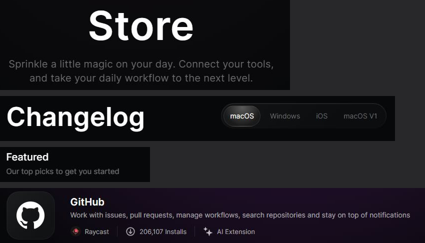

# Titres

Captures : titre « Store » et sa précision, titre « Changelog » et ses onglets, titre de section
« Featured », en-tête de la page d'extension.

## Relevé raycast.com

| Titre | Taille / interligne | Graisse | Interlettrage | Couleur | Autour |
|---|---|---|---|---|---|
| Page, Store (`h1`) | 80/86 | 600 | +1,2 px (0,015em) | blanc | centré ; précision 18 à 20 px en gris dessous |
| Page, Changelog (`h1`) | 52/55 | 600 | +0,52 px (0,01em) | blanc | à gauche ; onglets à droite, même ligne |
| Nom d'extension (`h1`) | 20/30 | 600 | 0 | blanc | résumé 14/21 en blanc 60 % dessous |
| Lisez-moi (`h1`) | 40/60 | 600 | 0 | blanc | |
| Section, « Featured » (`h3`) | 20/23 | 500 | 0 | blanc | marge basse 8 ; précision 15/17, blanc 40 %, marge basse 32 |
| Bloc latéral, « Contributors » | 12/18 | 500 | 0 | blanc 60 % | compteur à droite |

DESIGN.md annonçait un héros de 56 px en 400 : c'est le cas de l'accueil seulement ; les titres
de page sont en 600.

## Recette Catalog

| Composant | Recette |
|---|---|
| `PageHeader` (`src/components/PageHeader.tsx`) | titre seul, `text-heading` (32) puis `sm:text-heading-lg` (56), 600 ; précision `text-lg` en Ash, 12 dessous ; actions 32 dessous ; description à droite, alignée en bas ; trait pleine largeur |
| `SectionHeading` (`@/components/sections`) | `text-subheading` (20), 600 ; précision `text-sm` en Ash, 8 dessous ; action à droite |
| `FeaturedRow` | titre de section, puis 32 jusqu'aux cartes |
| `MediaRow` | titre de rangée en `text-subheading`, 600 |

Police : tous les titres (`h1` à `h4`) sont en **Bricolage Grotesque 600**, posés par une règle
de base de `globals.css` ; un titre n'écrit jamais sa graisse (`font-medium`, `font-normal`). Un
texte qui n'est pas un titre mais doit en avoir l'air prend `font-heading font-semibold`.

Écarts assumés :

- Police : Bricolage Grotesque au lieu d'Inter (choix de l'utilisateur, 2026-09-28) ; le héros de
  l'accueil passe en 600 (Raycast : 400).
- 56 px au lieu de 52 : l'échelle a un palier à 56 ; interlettrage du jeton (0,004em).
- Précision de section en 14 px Ash plutôt qu'en 15 px blanc 40 % (échelle, contraste).
- Pas de titre en deux tons (« Nom. Précision en gris ») : la précision passe dessous.

## Liste de contrôle

- [ ] Tout titre est en Bricolage Grotesque 600 ; aucune classe de graisse sur un `h1` à `h4`.
- [ ] Le titre de page est seul sur sa ligne, très grand à l'ordinateur ; jamais
      d'interlettrage négatif.
- [ ] La précision est dessous, en gris, plus petite, jamais dans le même `h1`.
- [ ] Titre de section en 20 px ; précision en gris juste dessous.
- [ ] Beaucoup d'air : 32 entre un titre de section et son contenu.
